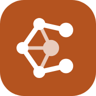
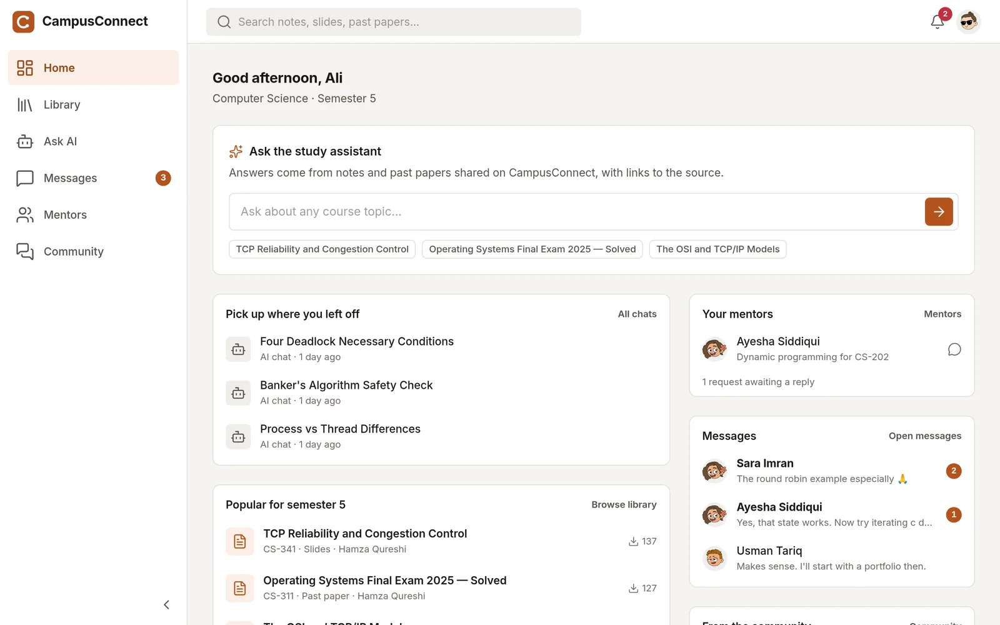
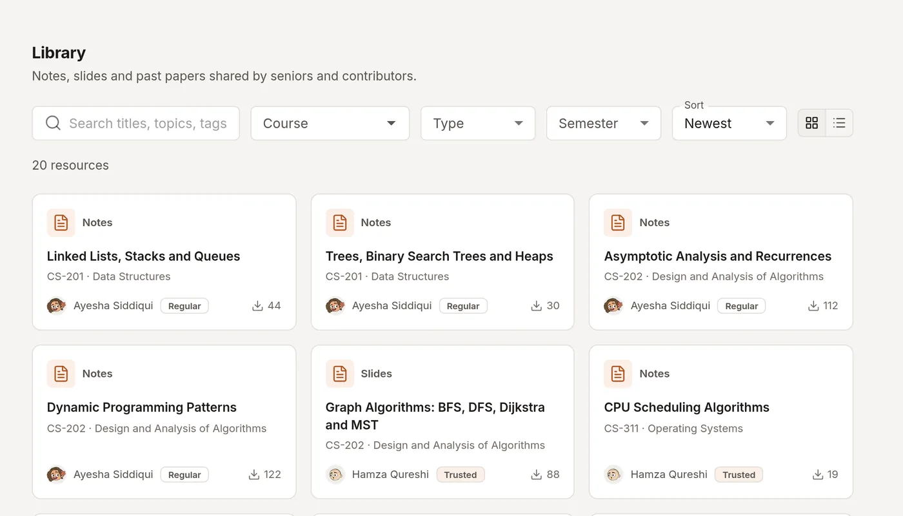
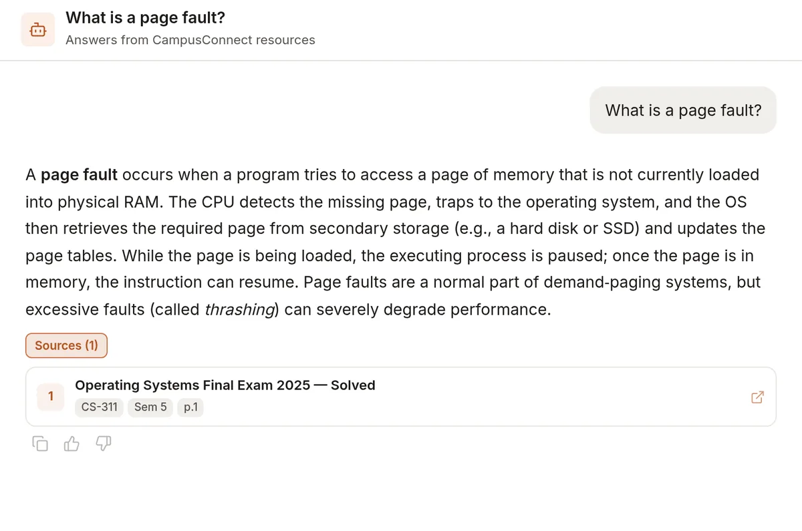
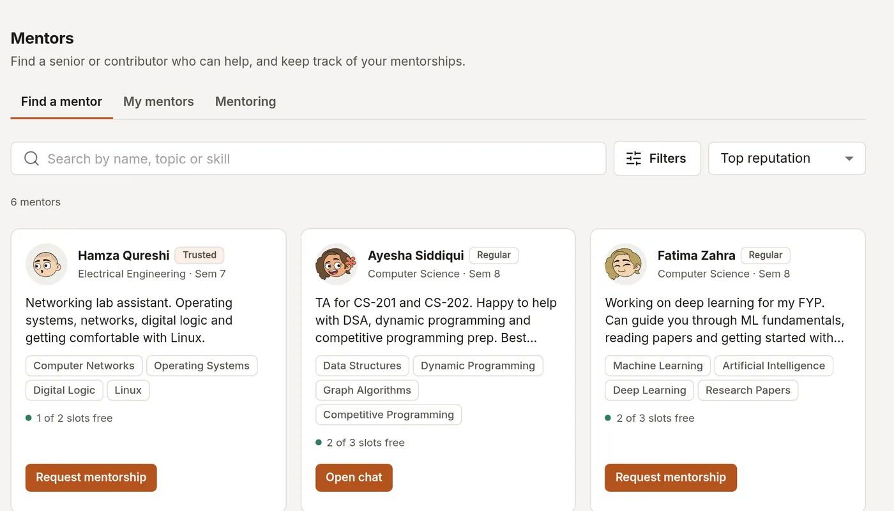
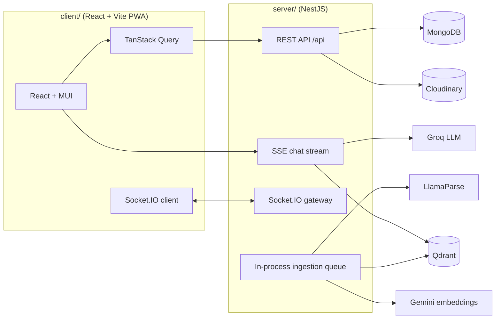

<div align="center">



# CampusConnect

**A university platform where students share notes, ask an AI tutor that cites its sources, and find mentors.**

[](https://github.com/iamrehman16/CampusConnect/actions/workflows/client-ci.yml)
[](https://github.com/iamrehman16/CampusConnect/actions/workflows/server-ci.yml)
[](LICENSE)


[Live demo](https://campus-connect-client-two.vercel.app) · [Report a bug](https://github.com/iamrehman16/CampusConnect/issues/new?template=bug_report.yml) · [Request a feature](https://github.com/iamrehman16/CampusConnect/issues/new?template=feature_request.yml)

</div>

---

## About

CampusConnect started as a Final Year Project at Quaid-i-Azam University (QAU),
supervised by Dr. Ghazanfar, and shipped as **v1** at the October 2026 open
house. It is now being developed into a full product, with multi-tenant
deployment for universities as the long-term goal.

It combines four things that usually live in separate apps:

- **A moderated resource library.** Seniors and contributors upload notes,
  slides and past papers; admins approve them before they go public.
- **An AI study assistant (RAG).** Approved documents are parsed, embedded and
  indexed. The assistant answers from them and cites the exact resource and
  contributor it used.
- **A real-time messenger and mentorship network.** Direct messages, mentor
  requests, ratings, endorsements and a reputation leaderboard.
- **An admin console.** Moderation queues, user and role management,
  contributor applications and analytics.

> The live demo runs on free tiers and may take 30–60 s to wake up.

## Screenshots

| Home | Library |
| :---: | :---: |
|  |  |
| **Ask AI** | **Mentors** |
|  |  |

## Features

| Area | What it does |
| --- | --- |
| **Auth** | Email/password with JWT access + rotating refresh tokens, Google sign-in, role-based access (Student, Contributor, Admin), onboarding flow |
| **Library** | Upload (signed Cloudinary uploads), search, filter by subject/course/semester/type, moderation workflow, infinite scroll |
| **Ask AI** | Streaming answers (SSE), named threads with persisted history, cross-session memory, deduplicated citations to source resources, "ask a human" hand-off to the author |
| **Ingestion pipeline** | On approval: LlamaParse → chunking → Gemini embeddings → Qdrant, via a durable in-process queue that resumes after restarts |
| **Messenger** | Socket.IO real-time chat, typing and unread indicators, reconnect and resync |
| **Community** | Posts, comments, upvotes, contributor discovery, public profiles |
| **Mentorship & reputation** | Mentor directory, requests, ratings, endorsements, reputation ledger, tiers, leaderboard |
| **Notifications** | In-app notifications plus opt-in Web Push (VAPID) per device |
| **Safety** | Block, report, moderation queue |
| **PWA** | Installable, read-only offline mode backed by IndexedDB |
| **Ops** | Fail-fast env validation at boot, `/api/health` dependency report, `/api/health/live` liveness probe |

## Architecture



This is a monorepo: `client/` and `server/` are independent projects, each
with its own `package.json` and lockfile. Some design choices look unusual
out of context but are intentional (manual SSE over `@Sse()`, no Redis, MD5
ObjectId → UUID for Qdrant point IDs). They are documented in
[`CLAUDE.md` §4](CLAUDE.md) and [`docs/decisions/`](docs/decisions).

### Tech stack

| Layer | Technologies |
| --- | --- |
| Frontend | React 19, TypeScript, Vite, MUI, React Router 7, TanStack Query, Zustand, React Hook Form, Recharts, Socket.IO client, `vite-plugin-pwa` |
| Backend | NestJS 11, TypeScript, Mongoose, Passport (JWT, local, Google), Socket.IO, `@nestjs/event-emitter`, class-validator |
| AI / RAG | Groq (LLM inference), Gemini `gemini-embedding-001` (3072-dim embeddings), Qdrant Cloud (vector store), LlamaParse (document parsing) |
| Storage | MongoDB Atlas, Cloudinary |
| Hosting | Vercel (client), Render (server, deploys only after CI passes) |

## Repository layout

```text
.
├── client/              React + Vite frontend (feature folders under src/features)
├── server/              NestJS backend (feature modules under src/modules)
│   └── scripts/seed-demo/   Repeatable demo dataset
├── docs/                Runbooks, demo guides, architecture decisions
├── scripts/             Local demo and warm-up helpers
├── .github/             CI workflows, issue and PR templates
├── render.yaml          Render blueprint for the API
├── BACKLOG.md           Open work and history
└── CLAUDE.md            Engineering principles and intentional decisions
```

## Getting started

### Prerequisites

- Node.js 20 or newer (CI uses current LTS)
- MongoDB 7 (local, Docker or Atlas). Use a replica set if you plan to run the demo seed, which uses transactions.
- API keys for the services you want to use: Groq, Gemini, Qdrant, LlamaParse, Cloudinary. The core app (auth, library browsing, chat, community) runs without the AI keys locally.

### 1. Clone

```bash
git clone https://github.com/iamrehman16/CampusConnect.git
cd CampusConnect
```

### 2. Server

```bash
cd server
cp .env.example .env      # fill in the values; the table at the top explains each one
npm install
npm run start:dev         # http://localhost:3100 (with PORT=3100)
```

The server validates its environment at boot and refuses to start if a
required variable is missing. See [`server/.env.example`](server/.env.example)
for the full contract.

### 3. Client

```bash
cd client
cp .env.example .env      # VITE_API_BASE_URL is the server origin, without /api
npm install
npm run dev               # http://localhost:5173
```

The Vite dev server proxies `/api` to `http://localhost:3100`.

### Optional: demo data

```bash
cd server
DEMO_MONGO_URI="mongodb://localhost:27017/campusconnect_demo" npm run seed:demo
```

The seed drops and rebuilds the target database (its name must end in
`_demo`). Details in [`server/scripts/seed-demo/README.md`](server/scripts/seed-demo/README.md).

## Scripts

| Where | Command | Purpose |
| --- | --- | --- |
| `client/` | `npm run dev` | Vite dev server |
| `client/` | `npm run build` | Typecheck (`tsc -b`) and production build |
| `client/` | `npm run lint` | ESLint |
| `server/` | `npm run start:dev` | NestJS in watch mode |
| `server/` | `npm run build` | Typecheck and compile |
| `server/` | `npm test` | Jest unit tests |
| `server/` | `npx eslint "{src,apps,libs,test}/**/*.ts"` | Lint without auto-fix (what CI runs) |
| `server/` | `npm run seed:demo` | Seed a demo database |

## Documentation

- [Contributing guide](CONTRIBUTING.md)
- [Engineering principles and intentional decisions](CLAUDE.md)
- [Architecture decision records](docs/decisions)
- [Post-deploy smoke test](docs/deploy-smoke-test.md)
- [Demo walkthrough](docs/demo-walkthrough.md)
- [Changelog](CHANGELOG.md)
- [Backlog](BACKLOG.md)

## Contributing

Contributions are welcome. Read [CONTRIBUTING.md](CONTRIBUTING.md) before
opening a pull request, and follow the [Code of Conduct](CODE_OF_CONDUCT.md).
Every PR into `main` must pass the client and server CI checks.

## Security

Please do not open public issues for vulnerabilities. See
[SECURITY.md](SECURITY.md) for how to report them privately.

## License

Copyright (C) 2026 Abdur Rahman.

CampusConnect is licensed under the [GNU Affero General Public License v3.0](LICENSE).
If you run a modified version of CampusConnect as a network service, the AGPL
requires you to make your modified source code available to its users.

## Acknowledgements

- Dr. Ghazanfar, project supervisor, and the faculty of Quaid-i-Azam
  University, for their guidance and feedback.
- The open-source projects this is built on: NestJS, React, MUI, TanStack
  Query, Socket.IO, Qdrant and many more.
